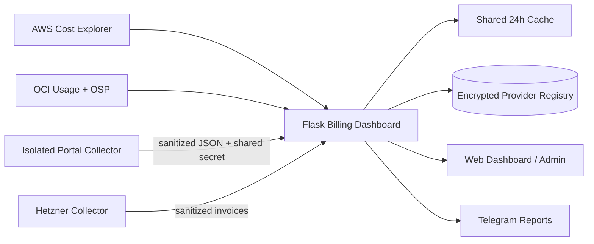

# Multi-Cloud Billing Dashboard — Portfolio Edition

A sanitized reference implementation of a multi-provider FinOps dashboard that normalizes cloud billing data, caches expensive API calls, exposes an admin-managed provider registry, receives billing data from isolated collectors, generates invoice views, and sends scheduled Telegram reports.

> **Portfolio safety:** all organizations, identifiers, invoices, endpoints, credentials, billing values, and demo records in this repository are fictional. This repository contains no production database, browser session, secret, customer record, or company-specific infrastructure data.

## What this project demonstrates

- **Multi-cloud normalization** across API-backed and collector-backed billing providers.
- **Provider registry** stored in SQLite with encrypted provider credentials using Fernet.
- **AWS Cost Explorer** and **OCI Usage/OSP** integration patterns.
- **Collector ingestion** for providers whose billing portal is not exposed through a suitable public billing API.
- **Authenticated push endpoints** that receive sanitized invoice data rather than portal credentials.
- **Shared 24-hour cache** with file locking for multi-process Passenger deployments.
- **Admin console** for enabling, ordering, testing, and configuring providers.
- **Telegram reporting** with per-group routing and unpaid-invoice alerts.
- **PDF invoice generation** for normalized invoice views.
- **Synthetic demo mode** so the dashboard can be explored without real cloud credentials.

## Architecture



## Quick demo

```bash
python3 -m venv .venv
source .venv/bin/activate
pip install -r requirements.txt
cp .env.example .env
```

Generate values for `SECRET_KEY`, `AUTH_PASSWORD_HASH`, and `PROVIDER_ENCRYPTION_KEY`, keep `DEMO_MODE=true`, then run:

```bash
python app.py
```

Demo mode returns synthetic billing metrics and does not call real cloud APIs.

## Provider model

Each provider implements a common metric surface:

- `kpis`
- `services`
- `trend`
- `daily`
- `resources`
- `invoices`
- `enhanced_kpis`

That allows the dashboard and Telegram layer to remain provider-agnostic.

## Security model

- Secrets are supplied through environment variables, never committed.
- Provider credentials are encrypted at rest in SQLite.
- Collector push endpoints use dedicated shared secrets.
- Browser credentials/cookies stay on isolated collectors and are never forwarded to the dashboard.
- Admin mutations use CSRF protection and audit logging.
- Repository rules exclude runtime databases, caches, logs, keys, cookies, and browser profiles.

See [`SECURITY.md`](SECURITY.md) and [`docs/privacy-and-compliance.md`](docs/privacy-and-compliance.md).

## Production note

This portfolio edition intentionally replaces real tenant/customer names and one proprietary portal integration with generic equivalents. Production deployment also requires provider-specific IAM design, secret rotation, monitoring, backups, and legal/security review.

## License / ownership

This repository is prepared as a portfolio publication candidate. The included license is intentionally restrictive until the source-code rights holder approves a permissive open-source license. See [`LICENSE`](LICENSE).
